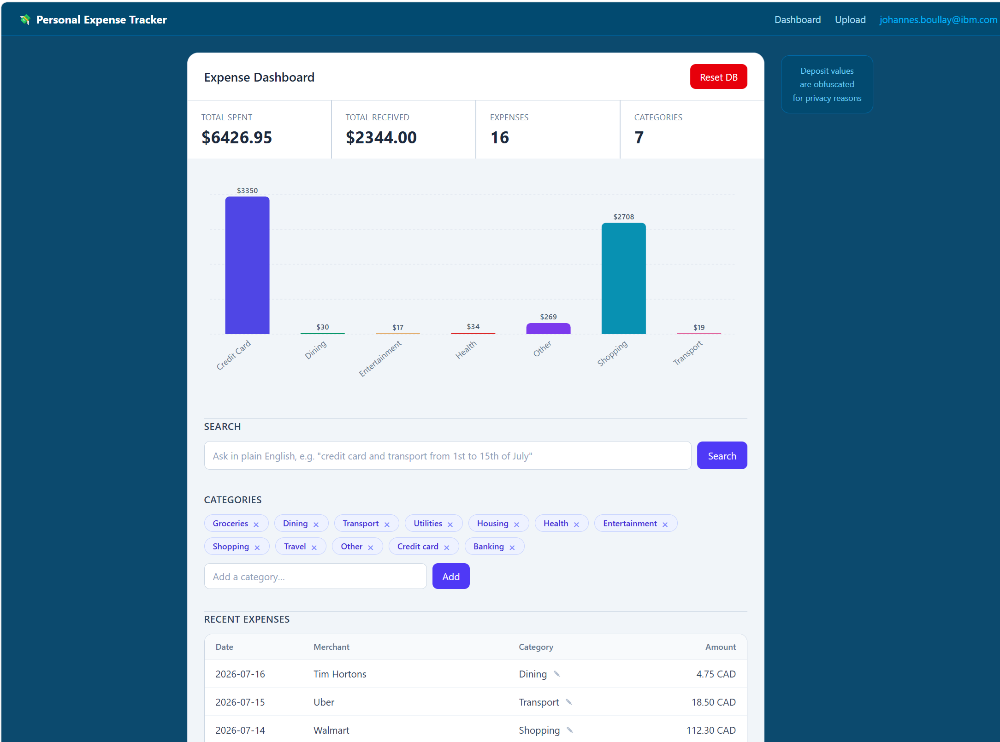

# Expense Tracker — watsonx Challenge Submission

## 1. One-line pitch

A production-grade, multi-tenant SaaS product that eliminates manual expense
entry: snap or upload any receipt and watsonx.ai extracts, categorizes, and
makes it queryable in seconds — built entirely on IBM Cloud.

## 2. Why it matters

There is no open-source or low-cost product that handles the full arc from
unstructured receipt (photo, scanned PDF, bank-statement CSV) to a structured,
searchable, self-improving expense record — without manual typing. This project
delivers that arc end-to-end on IBM Cloud, with a merchant-learning loop that
gets more accurate with every correction a user makes. It began as a single-inbox
Gmail agent and was deliberately evolved into a real multi-tenant web product
where each user's data is cryptographically isolated.

## 3. Architecture (all-IBM)

```
Browser (React SPA)
   │  upload receipt (image / pdf / csv)   +  JWT auth
   ▼
FastAPI backend ──► pipeline.process_file(user_id, ...)
   │                  │
   │                  ├─► IBM Cloud Object Storage (file, user_id/ref/name)
   │                  │
   │                  ├─► watsonx.ai
   │                  │      • Llama-3.2-11B-Vision  → OCR image receipts
   │                  │      • Granite-3-8B-Instruct → process CSV, text, PDF
   │                  │
   │                  └─► IBM Cloudant (expense docs, tagged with user_id)
   ▼
Dashboard  ◄── GET /api/expenses | /api/summary | /api/chart.png  (by user_id)
```

Two ingest paths share one processing core:
- **Web upload (primary):** browser → `/api/upload` → `pipeline.process_file`.
- **Gmail poller (secondary, retained):** cron → `run_once()` → same core.

### IBM services used

| Service | Role |
| --- | --- |
| watsonx.ai — Llama-3.2-11B-Vision | OCR of image receipts into structured lines |
| watsonx.ai — Granite-3-8B-Instruct | Normalize + categorize CSV / text-PDF rows |
| IBM Cloudant | Per-user expense documents (Mango index on `user_id`,`date`) |
| IBM Cloud Object Storage | Raw uploaded files, namespaced per user |
| IBM Code Engine (planned) | Single-container hosting (API + SPA) |

## 4. Demo script (5 minutes)

```
cd web/frontend && npm install && npm run build && cd ../..
uvicorn app:app --port 8000 --app-dir web/backend
# open http://localhost:8000
```

Screenshot:
   

1. **Register** → JWT issued, redirected to dashboard.
2. **Upload receipt image** → Llama-Vision OCRs it; categorized rows appear immediately.
3. **Upload CSV / bank-statement PDF** → Granite normalizes and categorizes every line.
4. **Dashboard** → summary cards, spend-by-category bar chart, expense table — scoped to the logged-in user.
5. **Natural-language query** → type "groceries from July 1st to 15th"; Granite returns a `{categories, date_from, date_to}` filter; dashboard updates instantly.
6. **Re-categorization with learning** → change a category inline; the choice is persisted as a merchant rule, back-applied to existing rows, and used on future uploads.
7. **Multi-tenant proof** → second registered user sees an empty, disjoint data set.
8. **Idempotency** → re-upload the same file; no duplicate rows (`sha256` doc IDs).


## 5. Deployment status — deploy-ready

Container-ready on IBM Code Engine. A live URL is pending a billing upgrade (Lite → Pay-As-You-Go); all artefacts are in the repo:

- `web/Dockerfile` — multi-stage build; Node builds SPA, Python serves API + SPA on one port.
- `web/README.md` — exact `ibmcloud ce` commands using `--build-source` (no local Docker daemon needed).
- `.dockerignore` — keeps secrets and build artefacts out of the image.

## 6. What's verified

- **Auth:** register / login and issue JWTs; bcrypt hashing; startup rejects weak/missing `JWT_SECRET`.
- **Pipeline:** full watsonx.ai ingest — OCR → categorize → store — on every authenticated upload.
- **Isolation:** `/api/expenses` and `/api/summary` return only the caller's data; second user sees an empty set.
- **NL query:** plain-English search parsed by Granite into a structured filter, applied server-side.
- **Learning loop:** one category correction persists a merchant rule, back-fills existing rows, auto-applies to future uploads.
- **Resilience:** `_extract_json` recovers rows from truncated model output.
- **Idempotency:** duplicate uploads produce no duplicate rows (`sha256` doc IDs).
- **Smoke tests:** `python web/backend/test_web_smoke.py` — full request cycle, no Docker required.

## 7. Repo map

| Path | Contents |
| --- | --- |
| `agent/` | AI core: router, parsers, watsonx_client, schema, store, pipeline |
| `web/backend/` | FastAPI: app, auth, users, deps, routes_upload, routes_expenses |
| `web/frontend/` | React + Vite + Tailwind CSS SPA (Login, Upload, Dashboard) |
| `web/Dockerfile` | Multi-stage production build |
| `web/README.md` | IBM Code Engine deploy commands |
